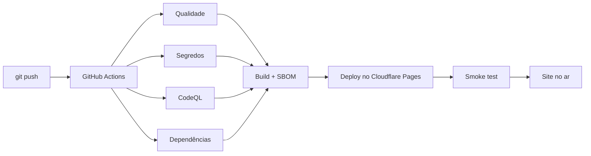

# Painel da Pipeline

Projeto final de Fundamentos de DevOps: aplicação web com CI/CD completo e gates de segurança (DevSecOps).



- **Pull Request** gera um *preview* em URL própria. **Merge na `main`** publica em produção.
- O site lê `version.json` (commit, build, autor, resultado dos gates) gerado no build, então cada alteração aparece na URL pública.
- Sem dependências npm: lint usa `node --check` e testes usam o runner nativo do Node 20+.

## Rodar local
```bash
npm run lint && npm test && npm run build && npx serve dist   # http://localhost:3000
```

## Configuração (uma vez)
1. Crie o repositório no GitHub (**público**, para o atestado de proveniência funcionar) e faça o primeiro push.
2. No Cloudflare: Workers & Pages > Create > Pages > **Upload assets** (Direct Upload), crie o projeto e defina `main` como branch de produção. Não conecte ao Git, para não haver deploy duplicado.
3. Crie um API Token com permissão **Cloudflare Pages: Edit** e anote o Account ID.
4. GitHub > Settings > Secrets and variables > Actions:
   - Secrets: `CLOUDFLARE_API_TOKEN`, `CLOUDFLARE_ACCOUNT_ID`
   - Variable: `CF_PROJECT_NAME` (nome do projeto Pages)
5. Settings > Environments: crie `production` e `preview` (opcional: exigir aprovação em `production`).
6. Settings > Branches: (opcional) proteja a `main` exigindo os checks **Qualidade**, **Segredos**, **Código (CodeQL)** e **Dependências**.
7. Em Settings > Code security, deixe o *Code scanning default setup* **desativado** (o CodeQL já roda no workflow) e ative o Dependabot.

Observação: as actions estão fixadas por tag. Para endurecer a cadeia de suprimentos, fixe por SHA de commit (o Dependabot mantém as atualizações).


